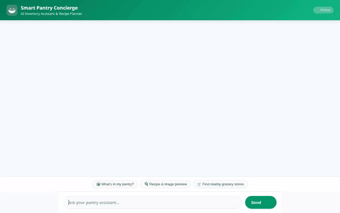

# Smart Pantry Concierge 🥗

Smart Pantry Concierge is an AI agent that manages pantry inventory, suggests recipes based on available ingredients, checks dietary restrictions, generates dish images and videos, and finds nearby grocery stores.



---

## 🌟 Implemented Features & Architecture

Based on the codebase in `app/` and `agents-cli-manifest.yaml`, the agent implements the following capabilities:

### 1. 📦 Pantry Inventory Management (Firestore)
- **Database Backend**: Managed via Google Cloud Firestore (`pantry_items` collection).
- **Tools**:
  - `list_pantry_items`: Stream and retrieve current pantry stock (quantity, unit, category).
  - `update_pantry_item`: Add new items or update stock quantities in Firestore.

### 2. 🧠 Dietary Safety & Preference Tracking (Vertex AI Memory Bank)
- **Service**: Integrated with `VertexAiMemoryBankService`.
- **Tools & Callbacks**:
  - `PreloadMemoryTool`: Automatically loads saved user memories into conversation context before each turn.
  - `generate_memories_callback`: Persists dietary allergies, intolerances, and preferences to Memory Bank after each turn.
  - **Dietary Safety Enforcement**: System prompt strictly enforces allergy checking before suggesting any recipe.

### 3. 🍳 Recipe Planning & Nutritional Analysis
- **Tools**:
  - `list_recipes`: Matches available pantry items against stored recipes (e.g., Spaghetti Aglio e Olio, Garlic Tomato Pasta).
  - `calculate_recipe_nutrition`: Calculates total calories, protein, carbohydrates, and fats for recipes using a nutrition lookup table.
  - `search_online_recipes`: Searches Google for online recipes when local suggestions are insufficient.

### 4. 🎨 Multimodal Image & Video Generation
- **Image Generation (`generate_recipe_image`)**:
  - Uses `gemini-3.1-flash-lite-image` model.
  - Saves generated images as artifacts via `tool_context.save_artifact`.
  - Directly uploads image bytes to public Google Cloud Storage bucket (`smart-pantry-assets-62968065`).
- **Omni Video Generation (`generate_recipe_video`)**:
  - Uses Google's `gemini-omni-flash-preview` model in the `global` region via `client.interactions.create`.
  - Saves video bytes as artifacts and uploads to Cloud Storage for public access.

### 5. 📍 Location & Grocery Store Discovery (Google Maps APIs)
- **Tools**:
  - `geocode_address`: Converts address strings to latitude/longitude coordinates.
  - `find_nearby_places`: Searches for nearby grocery stores and supermarkets using Places API.

### 6. 💻 Agent Engine Sandbox Execution & A2UI
- **Code Execution**: `AgentEngineSandboxCodeExecutor` safely executes Python code in isolated sandbox environments.
- **A2UI Interface**: Uses `A2uiSchemaManager` (v0.8 Basic Catalog) wired as an `after_model_callback` to produce structured JSON component layouts for supported web clients.

---

## 🧰 Google Cloud Services Integrated

- **Vertex AI Agent Engine (Agent Runtime)**: Hosts the deployed agent backend.
- **Vertex AI Memory Bank**: Manages long-term conversational memory and preference extraction.
- **Google Cloud Firestore**: Persists pantry inventory records.
- **Google Cloud Storage**: Stores generated recipe images (`recipe_images/`) and videos (`recipe_videos/`).
- **Google Maps Platform**: Geocoding and Places APIs for grocery store discovery.
- **Cloud Run**: Hosts the FastAPI proxy and frontend user interface.

---

## 🚀 Local Development & Execution

### Prerequisites
- Python 3.11+
- `uv` package manager (or `pip`)
- Google Cloud SDK (`gcloud`) authenticated with ADC (`gcloud auth application-default login`)

### Setup Instructions

1. **Clone & Setup Environment**:
   ```bash
   git clone <repository-url>
   cd smart-pantry-concierge
   uv sync
   ```

2. **Set Environment Variables**:
   ```bash
   export GOOGLE_MAPS_API_KEY="<your-google-maps-api-key>"
   ```

3. **Start the Agent Backend (Playground)**:
   ```bash
   agents-cli playground app
   ```

4. **Start the Frontend Proxy Server**:
   ```bash
   cd frontend
   uv run python main.py
   ```
   The local web chat frontend will run on port 8080.

---

## 🛠️ Deployment Instructions

### Deploy Agent Backend to Agent Platform:
```bash
agents-cli deploy --update-env-vars GOOGLE_MAPS_API_KEY=$GOOGLE_MAPS_API_KEY --no-confirm-project
```

### Deploy Frontend to Cloud Run:
```bash
cd frontend
gcloud run deploy smart-pantry-frontend \
  --source . \
  --region us-east1 \
  --allow-unauthenticated \
  --set-env-vars AGENT_ENGINE_RESOURCE_NAME=<your-agent-resource-name>,AGENT_DIRECTORY=app
```
